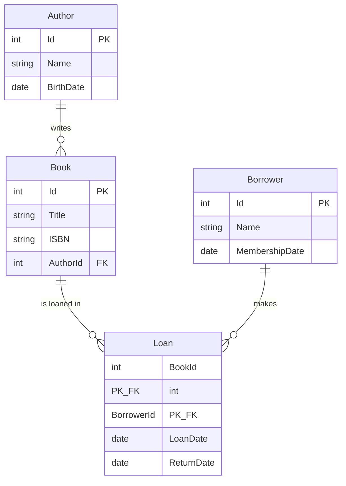

# Library System – EF Core

## تشغيل
    dotnet tool install --global dotnet-ef        (مرة واحدة)
    dotnet ef migrations add InitialCreate
    dotnet ef database update
    dotnet run

(أو من Package Manager Console: `Add-Migration InitialCreate` ثم `Update-Database`).
غيّر الـ connection string في `Data/LibraryDbContext.cs` لو الـ SQL Server عندك مختلف.

## الـ Relationships

| العلاقة | النوع | الإعداد |
|---|---|---|
| Author → Book | One-to-Many | `HasOne(Author).WithMany(Books).HasForeignKey(AuthorId)` |
| Book ↔ Borrower | Many-to-Many | من خلال `Loan` (`UsingEntity<Loan>()`) |
| Loan | Join entity | Composite PK (`BookId`, `BorrowerId`) + `LoanDate`, `ReturnDate` |

## ER Diagram

## لاحظ
- الأسايمنت طالب **screenshot للـ DB Diagram**: بتتاخد من SSMS (Database Diagrams) بعد `Update-Database`،
  أنا ماقدرش أطلعه من هنا.
- الـ PK بتاع Loan (`BookId + BorrowerId`) معناه إن نفس المستعير مينفعش يستعير نفس الكتاب مرتين.
  لو عايز تسمح بكده زوّد `LoanDate` للـ key أو اعمل `Id` مستقل.
