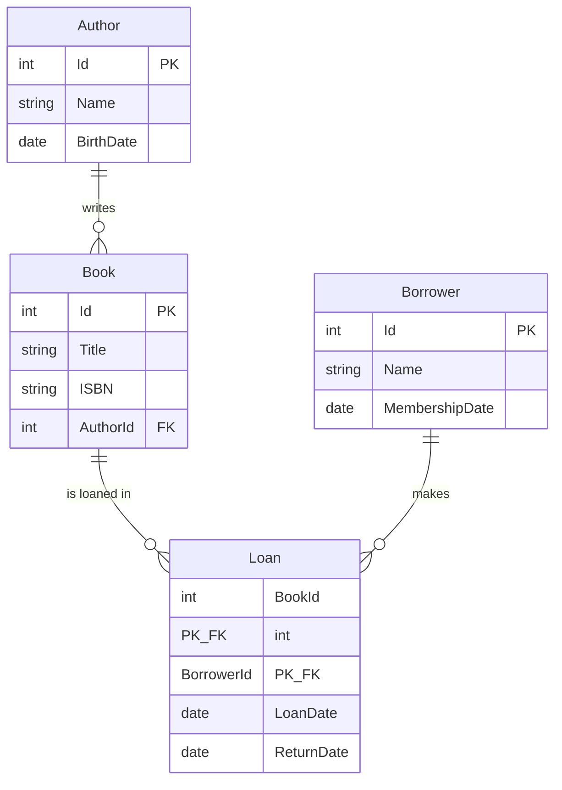

# Library System – EF Core

    dotnet tool install --global dotnet-ef        
    dotnet ef migrations add InitialCreate
    dotnet ef database update
    dotnet run

|---|---|---|
| Author → Book | One-to-Many | `HasOne(Author).WithMany(Books).HasForeignKey(AuthorId)` |
| Book ↔ Borrower | Many-to-Many | من خلال `Loan` (`UsingEntity<Loan>()`) |
| Loan | Join entity | Composite PK (`BookId`, `BorrowerId`) + `LoanDate`, `ReturnDate` |

## ER Diagram

